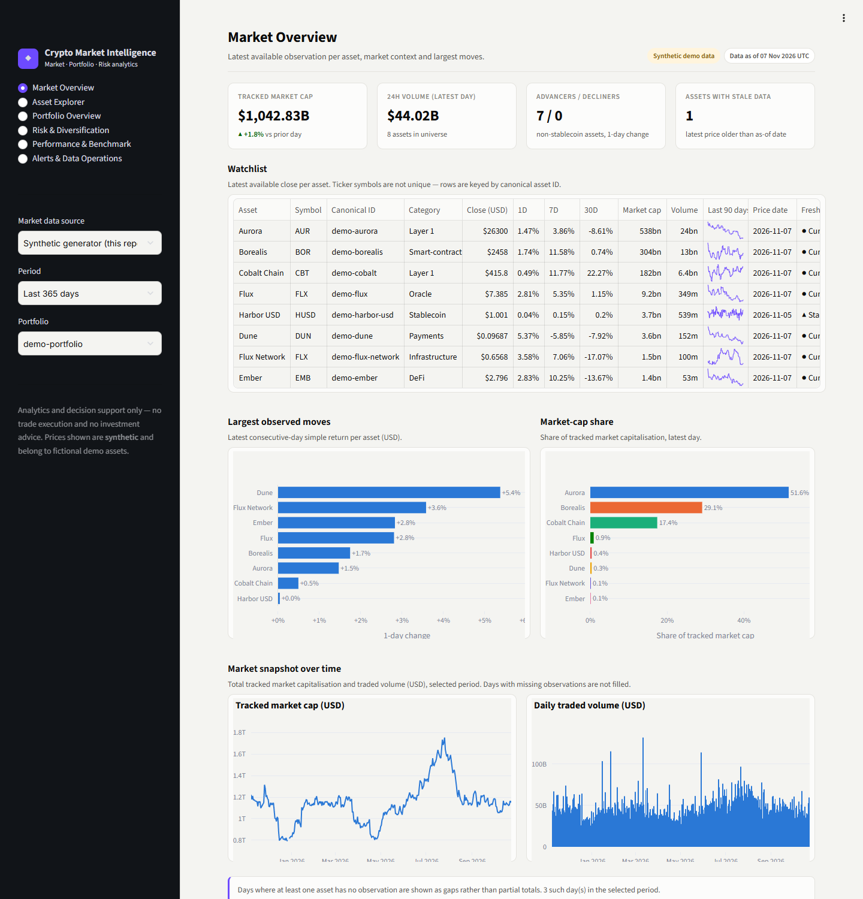
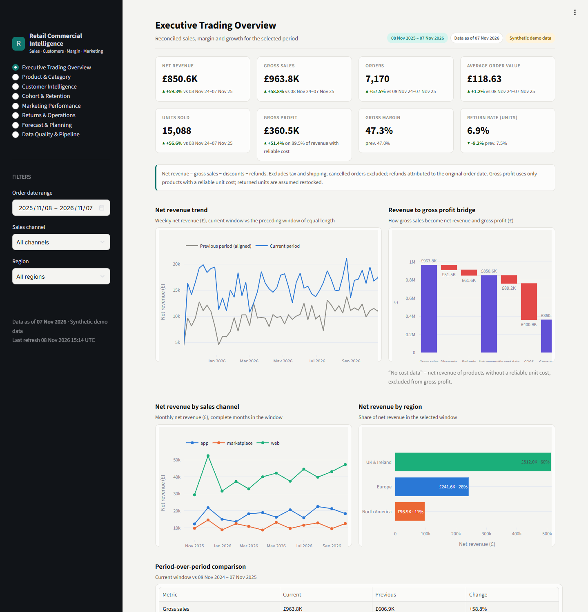
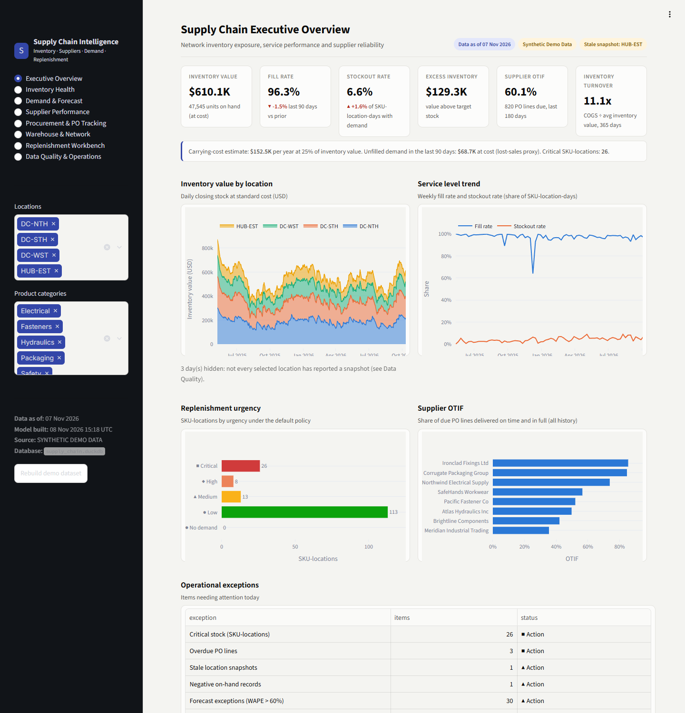
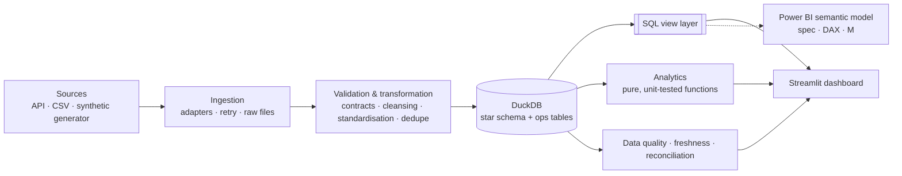

<div align="center">

# Analytics Engineering & BI Portfolio

**Three end-to-end business intelligence case studies: from raw data to tested KPIs and interactive dashboards.**


</div>

> **About this repository.** Each project turns a client-style project brief into a working analytics product. It covers ingestion, validation, dimensional modelling, KPI logic, data-quality monitoring, dashboards, tests and documentation. All demonstration data is **synthetic** and generated reproducibly. These are portfolio projects, not client deployments, and no figure in them is a real business result.

| | Project | Domain | Pages | Tests |
|---|---|---|---|---|
| 🪙 | [Crypto Market Intelligence & Portfolio Analytics](crypto-market-intelligence/) | Fintech / market data | 6 | 64 |
| 🛒 | [Retail & E-commerce Commercial Intelligence](retail-ecommerce-analytics/) | Retail / e-commerce | 8 | 53 |
| 📦 | [Supply Chain & Inventory Optimisation Intelligence](supply-chain-inventory-analytics/) | Operations / supply chain | 8 | 77 |

---

## 🪙 Crypto Market Intelligence & Portfolio Analytics



**Business problem:** crypto investors work from scattered exchange exports, colliding ticker symbols and price feeds with silent gaps. They cannot say with confidence what a portfolio is worth, what it cost, how much has been realised or how risky it is.

**Solution:** a market and portfolio analytics platform. A pluggable data-provider adapter (CoinGecko, or an offline synthetic provider) feeds a DuckDB star schema. On top of it sit a FIFO accounting engine, risk analytics, an alert engine and a data-operations console.

**Key capabilities**
- Ingestion with pagination, client-side rate limiting, retry with exponential backoff that honours `Retry-After`, raw-payload lineage, idempotent upserts and a recovery re-run for failed assets
- Canonical asset IDs (two demo assets deliberately share a ticker), UTC timestamps, observation time kept separate from retrieval time, and missing prices **never forward-filled**
- A ledger for BUY, SELL, TRANSFER_IN, TRANSFER_OUT and FEE: FIFO lots, a realised P&L audit trail, transfers that are never treated as trades, oversell rejection, manual entry and CSV import
- Volatility, drawdown, correlation, Sharpe (with stated assumptions), HHI concentration, time-weighted returns against benchmarks, and an optional backtest that discloses survivorship bias
- Configurable price, percentage-move, volume-spike and stale-data alerts, plus a console showing missing intervals, duplicates, freshness and failed runs

**Tech:** Python · pandas · DuckDB SQL · requests · Streamlit · Plotly · pytest  →  **[Open the project](crypto-market-intelligence/)**

```bash
cd crypto-market-intelligence && pip install -r requirements.txt && streamlit run app.py
```

---

## 🛒 Retail & E-commerce Commercial Intelligence



**Business problem:** finance, merchandising and marketing each report a different revenue figure. Discounts, refunds, cancellations, tax and shipping are treated inconsistently, and spend gets joined to order lines in ways that double-count.

**Solution:** a reconciled commercial analytics platform. Multi-currency extracts are validated, cleaned, converted to GBP and loaded into a star schema with explicit grains. Every KPI follows one documented rule, and the totals reconcile across fact tables, SQL views and Python.

**Key capabilities**
- Schema contracts, rejects with reasons, deduplication, FX standardisation, order-to-item reconciliation, freshness checks and a failed-load log
- Net revenue, gross profit (only where a reliable product cost exists, with coverage shown), margin, AOV, return rate and period-over-period comparison
- RFM segmentation, new vs returning customers, first-purchase cohort retention, time to next purchase, and **observed** vs **modelled** customer value
- A last-click **attribution bridge** at its own grain, so spend is never joined to order lines. CAC and ROAS carry explicit caveats against causal readings.
- Category forecasts chosen by backtest WAPE, with MAE, bias, intervals and an exception list

**Tech:** Python · pandas · DuckDB SQL · statsmodels · Streamlit · Plotly · pytest  →  **[Open the project](retail-ecommerce-analytics/)**

```bash
cd retail-ecommerce-analytics && pip install -r requirements.txt && streamlit run app.py
```

---

## 📦 Supply Chain & Inventory Optimisation Intelligence



**Business problem:** inventory, purchase orders, receipts and demand sit in separate systems with different units of measure, currencies and refresh times. Planners cannot see stockout risk, excess stock or how reliable suppliers really are, and replenishment runs on gut feel.

**Solution:** an inventory and supplier analytics platform. Five facts at different grains (snapshots, movements, demand, PO lines, receipts) are kept separate on shared dimensions and aggregated to a common grain before they are combined. On top sit planning analytics and a replenishment workbench that keeps the planner in charge.

**Key capabilities**
- UoM (case → each) and currency standardisation; duplicate, negative-stock and orphan-key checks; a quarantine table; snapshot-freshness checks; snapshot vs opening + movements reconciliation
- On-hand, available, reserved and in-transit stock; days of cover; FIFO ageing; excess and slow-moving stock; turnover; fill rate and stockout rate
- ABC (annual consumption value) and XYZ (demand variability) classification, plus forecasts using moving average, SES, seasonal naive or Croston, chosen by rolling-origin backtest WAPE, MAE and bias
- OTD and OTIF with a documented partial-receipt rule, lead-time mean, spread and p90, and a supplier scorecard
- Safety stock `z·√(LT·σd² + d²·σLT²)`, reorder point, target stock and order quantities rounded to MOQ and case pack. What-if levers cover demand uplift, supplier delay and service level. Planner review status is saved, and **no purchase order is ever created automatically**.

**Tech:** Python · pandas · NumPy · DuckDB SQL · Streamlit · Plotly · pytest  →  **[Open the project](supply-chain-inventory-analytics/)**

```bash
cd supply-chain-inventory-analytics && pip install -r requirements.txt && streamlit run app.py
```

---

### Ucompare Insurance Analytics Prototype

**Development Period:** April 2024 – June 2024

An insurance comparison analytics prototype featuring Python-based analysis, SQL, Databricks templates, Excel dashboards and Power BI reporting. All records and metrics are synthetic demonstration data, not actual Ucompare or JAD Marketing performance.

[View Project](ucompare-insurance-analytics/README.md)

---

## Portfolio architecture

All three projects follow the same layered pattern, but each is **independently runnable**, with its own dependencies, database, tests and app.



| Layer | Local implementation | Scale-up path (documented in each project) |
|---|---|---|
| Raw storage | JSON / CSV under `data/raw` | Bronze Delta tables (Auto Loader) |
| Transformation | pandas + SQL | PySpark / Delta Live Tables |
| Warehouse | DuckDB star schema | Gold Delta tables, Databricks SQL |
| Semantic layer | `database/views.sql` | Databricks SQL views + Power BI model |
| Presentation | Streamlit + Plotly | Power BI (DAX measures and M queries provided) |
| Orchestration | `python pipeline.py` | Databricks Workflows / Airflow |
| Quality | `ops_dq_results` + pytest | DLT expectations / Great Expectations |

More detail: [docs/architecture/portfolio_architecture.md](docs/architecture/portfolio_architecture.md). There is also a static landing page at [docs/index.html](docs/index.html).

## Technology overview

| Area | Tools |
|---|---|
| Languages | Python 3.11+, SQL |
| Data processing | pandas, NumPy |
| Analytical database | DuckDB (embedded, columnar, zero-config) |
| Statistics / forecasting | statsmodels (Holt / exponential smoothing in retail), NumPy implementations of moving average, SES, seasonal naive and Croston (supply chain) |
| Visualisation | Streamlit, Plotly, a shared design system (`dashboards/theme.py`) |
| BI modelling | Power BI semantic-model specs, DAX measures, Power Query M |
| Quality | pytest (unit, integration, data quality, Streamlit `AppTest` smoke tests), GitHub Actions |

**Design choices that hold across all three projects**
- **No hardcoded KPIs.** Every number on screen is computed from the model.
- **Explicit grain.** Each fact table states its grain, and grain is enforced by tests. Different grains are never joined row to row.
- **Visible failures.** Rejected rows, duplicates, gaps, stale data and reconciliation differences are logged and shown in the app.
- **Honest labelling.** Every page shows a "Synthetic demo data" badge and a data-as-of timestamp. Forecasts and recommendations are decision support only.

## Run everything

Requires Python 3.11 or newer. No API keys or cloud services are needed.

```bash
git clone <this-repository-url>
cd analytics-portfolio

# pick a project
cd crypto-market-intelligence            # or retail-ecommerce-analytics / supply-chain-inventory-analytics
python -m venv .venv

# Activation command :

Windows CMD	: .venv\Scripts\activate
Windows PowerShell : .venv\Scripts\Activate.ps1
Linux / macOS : source .venv/bin/activate

# continue

pip install -r requirements.txt

pytest                                   # run the test suite
python pipeline.py                       # build the data 
streamlit run app.py                     # start builds the synthetic demo database
```

To run all three apps side by side, use different ports: `--server.port 8601`, `8602` and `8603`.
`scripts/capture_screenshots.py` regenerates the README screenshots (it needs `pip install playwright` and a locally installed Edge or Chrome).

## Repository layout

```
analytics-portfolio/
├── crypto-market-intelligence/        # Project 1
├── retail-ecommerce-analytics/        # Project 2
├── supply-chain-inventory-analytics/  # Project 3
│   ├── app.py · pipeline.py · requirements.txt
│   ├── config/ ingestion/ transformations/ database/ analytics/ dashboards/
│   ├── power_bi/  (semantic model spec, DAX, M, report spec)
│   ├── tests/     (unit · integration · DQ · app smoke)
│   └── docs/      (architecture, ER diagram, data dictionary, source-to-target, KPI catalogue, sample data, setup)
├── docs/
│   ├── architecture/   portfolio architecture
│   ├── screenshots/    dashboard screenshots
│   ├── portfolio/      review notes
│   └── index.html      static landing page
├── scripts/capture_screenshots.py
└── .github/workflows/tests.yml          # 3 projects × Python 3.11 / 3.12
```

## Disclaimers
- All datasets are synthetic and generated by code in this repository. Fictional names are used for assets, brands, customers and suppliers.
- The crypto project can optionally load real data from the public CoinGecko API. That data is subject to CoinGecko's terms, and the project neither executes trades nor gives investment advice.
- Forecasts, risk metrics and replenishment suggestions are decision-support outputs and need validation on real data before any operational use.
- No `.pbix` file is included. The `power_bi/` folders hold specifications and code for building one.
